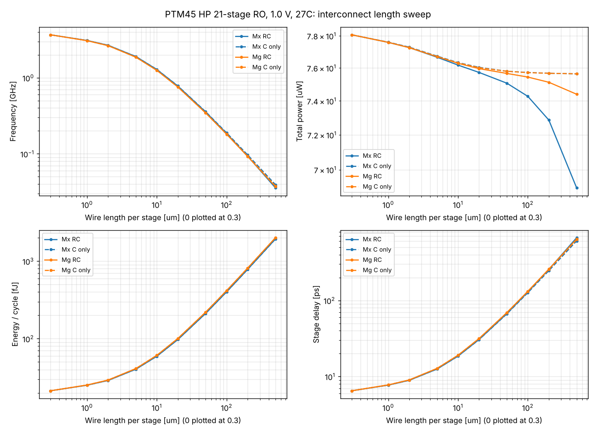
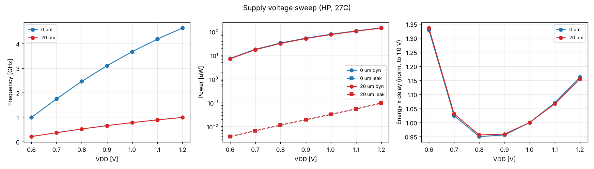
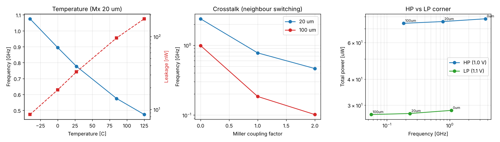

# PTM 45nm Ring Oscillator: Interconnect Parasitic 포함 분석

`python3 ringosc.py` 실행 시 전 스윕을 수행하고 `results/`에 CSV·PNG·`summary.txt`를 생성합니다
(순차 실행 약 4분, `RO_JOBS=N`으로 병렬 가능). 저장된 CSV로 그림·분석만 다시 만들려면
`python3 ringosc.py --analyze-only`.

## 1. 회로 구성

| 항목 | 값 |
|---|---|
| 모델 | PTM 45nm HP (BSIM4, `../pdk/ptm45/ptm45.lib hp`), LP 비교 |
| 구조 | 21단 = NAND2(enable) 1 + 인버터 20 |
| 인버터 | Wn/Wp = 90n/180n, L = 45n (NAND2 직렬 NMOS 180n) |
| 소스/드레인 | Ldiff = 90 nm 로 AD/AS/PD/PS 지정 → 접합 커패시턴스 반영 |
| 배선 | 각 단 출력 → 다음 단 입력에 distributed RC (π 세그먼트, ~150 Ω당 1개, 최대 10) |
| 측정 | v(in1) Vdd/2 상승 교차로 주기, 정수 주기 구간에서 I(VDD) 적분 → 평균 전력 |
| 누설 | EN=0으로 링 정지 상태의 DC 동작점 I(VDD) |

### 배선 parasitic 모델 (`interconnect.py`)

PTM interconnect 의 closed-form 식(양옆 이웃 + 접지면, Wong et al. TED 2000)으로 C, 크기효과 반영
유효 비저항으로 R 계산. 45nm 노드 ITRS 2007 수준의 기하 구조 가정.

| 층 | W/S/T/H [nm] | k | ρeff [µΩ·cm] | r [Ω/µm] | Cg [fF/µm] | Cc(편측) [fF/µm] | Ctot (MCF=1) |
|---|---|---|---|---|---|---|---|
| Mx (intermediate) | 70/70/140/140 | 2.9 | 3.52 | 3.59 | 0.026 | 0.077 | **0.180** |
| Mg (semi-global) | 140/140/300/300 | 2.9 | 2.60 | 0.62 | 0.024 | 0.082 | **0.187** |

Ctot = Cg + 2·MCF·Cc. 커패시턴스의 ~85%가 이웃 배선과의 coupling 입니다.

## 2. 결과 요약 (HP, 1.0 V, 27 °C, Mx)

| 단당 배선 [µm] | f [GHz] | 단 지연 [ps] | P_total [µW] | E/cycle [fJ] | Ceff/단 [fF] |
|---|---|---|---|---|---|
| 0 | **3.669** | 6.49 | 78.1 | 21.3 | 1.01 |
| 1 | 3.092 | 7.70 | 77.6 | 25.1 | 1.20 |
| 5 | 1.900 | 12.5 | 76.7 | 40.4 | 1.92 |
| 10 | 1.283 | 18.6 | 76.2 | 59.4 | 2.83 |
| 20 | 0.777 | 30.6 | 75.7 | 97.5 | 4.64 |
| 50 | 0.355 | 67.2 | 75.1 | 212 | 10.1 |
| 100 | 0.185 | 129 | 74.3 | 402 | 19.1 |
| 500 | 0.0357 | 667 | 69.0 | 1932 | 92.0 |

누설전력: 32.7 nW (총 전력의 0.04%).

## 3. 분석

### 3.1 배선 C 가 주파수를 지배
- 1 µm 배선(0.18 fF)만으로도 f 가 16% 감소, 20 µm 에서 79% 감소. 인버터 자체 부하(≈1.0 fF: 게이트+드레인 접합+overlap)가
  매우 작아서 수 µm 배선 C 가 금방 지배적이 됩니다.
- 단 지연 ≈ 6.5 ps + 6.67 ps/fF × Cwire → 등가 구동 저항 **Reff ≈ 9.7 kΩ** (0.69·Reff·C 기준).
- P_dyn 으로 역산한 단당 Ceff 증가율 0.182 fF/µm 가 배선 모델 0.180 fF/µm 와 1% 이내로 일치 → 측정 방법 검증.

### 3.2 배선 R 의 영향 (distributed RC vs C-only)
시뮬레이션 지연 차이가 Elmore 분포 RC 항 0.38·Rw·Cw 와 거의 정확히 일치합니다.

| 배선 | Mx 시뮬 / Elmore [ps] | 단 지연 대비 | Mg 시뮬 / Elmore [ps] | 단 지연 대비 |
|---|---|---|---|---|
| 100 µm | 2.56 / 2.45 | 2.0% | 0.49 / 0.44 | 0.4% |
| 200 µm | 9.92 / 9.81 | 3.9% | 1.91 / 1.76 | 0.7% |
| 500 µm | 61.3 / 61.3 | 9.2% | 11.0 / 11.0 | 1.7% |

- Rw ≪ Reff(9.7 kΩ) 인 한 R 영향은 작습니다. Mx 에서 R 효과가 10% 가 되는 지점이 ≈500 µm,
  Rw = Reff 가 되는 길이는 ≈2.7 mm(Mx). **수백 µm 이하 로컬 배선은 C 가 핵심, R 은 2차 효과.**
- 긴 배선을 상위층(Mg)으로 올리면 C 는 거의 같지만 R 이 1/6 → R 패널티가 1/5 수준.

### 3.3 전력: 링 오실레이터는 부하와 무관하게 거의 일정
- P = N·Ceff·V²·f 인데 f ≈ 1/(2N·0.69·Reff·Ceff) → **P ≈ V²/(2·0.69·Reff) ≈ 75 µW**, C 가 상쇄됩니다
  (시뮬 69–78 µW). 그래서 배선 비교는 전력이 아니라 **사이클당 에너지(= N·Ceff·V²)** 로 해야 하며,
  이는 배선 길이에 선형 비례(21 fJ → 97 fJ @20 µm).
- 긴 RC 배선에서 전력이 조금 떨어지는 것은 R 이 원단(far-end) 전이를 느리게 해 단락전류/주파수가 줄기 때문.
- 0 µm 에서 swing 1.056 V(>Vdd)는 Cgd 를 통한 피드스루 오버슈트이며, 배선 C 가 늘면 사라짐.

### 3.4 Crosstalk (Miller coupling factor)
| 배선 | MCF=0 | MCF=1 | MCF=2 |
|---|---|---|---|
| 20 µm | 2.39 GHz | 0.777 GHz | 0.464 GHz |
| 100 µm | 0.990 GHz | 0.185 GHz | 0.102 GHz |

coupling 비중이 커서 이웃 배선 스위칭 방향에 따라 f 가 **최대 5–10배** 변합니다. 실제 레이아웃에서는
shielding·spacing 확대가 지연 변동 억제에 결정적입니다.

### 3.5 전원전압 / 온도 / 공정 코너
- **Vdd 0.6→1.2 V**: f 0.99→4.64 GHz (0 µm), E/cycle ∝ V². **EDP 최소점 ≈ 0.8 V** (0 µm, 20 µm 공통).
- **온도 −40→125 °C** (20 µm): f 1.075→0.474 GHz (−56%, 이동도 감소), 누설 8.5→175 nW(20배),
  E/cycle 은 거의 일정(97–98 fJ). 125 °C 에서도 누설은 총 전력의 0.4%.
- **LP 코너 (1.1 V)**: f 는 HP 의 약 1/3.5 (1.06 GHz), 누설은 0.28 nW 로 **HP 대비 1/116**.
  E/cycle 은 Vdd 가 높아 HP 보다 약간 큼.

## 4. 가정 및 한계
- 배선 기하/비저항은 ITRS 45nm 수준의 가정치이며 실제 공정 PDK 의 RC 추출(PEX) 결과와 다를 수 있음.
- 비아 저항, 프린지 외 3차원 효과, 상부 접지면, 인덕턴스는 미포함. 단당 배선은 모두 동일 길이.
- PTM 모델은 예측 모델로 실제 실리콘과 다를 수 있고 공정 편차(Monte Carlo)는 미포함.
- 누설 DC 동작점에서만 `rbodymod=0` 사용: `rbodymod=1` 에서 ngspice DC 해석이 비물리적 해(한 소자에 ~170 µA)로
  수렴하는 경우가 있어 우회. DC 에서 body 전류는 ≈0 이라 결과에 영향 없음(정상 수렴 시 값과 동일 확인).
